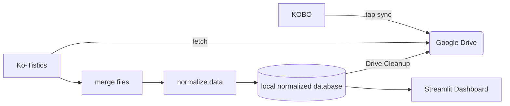
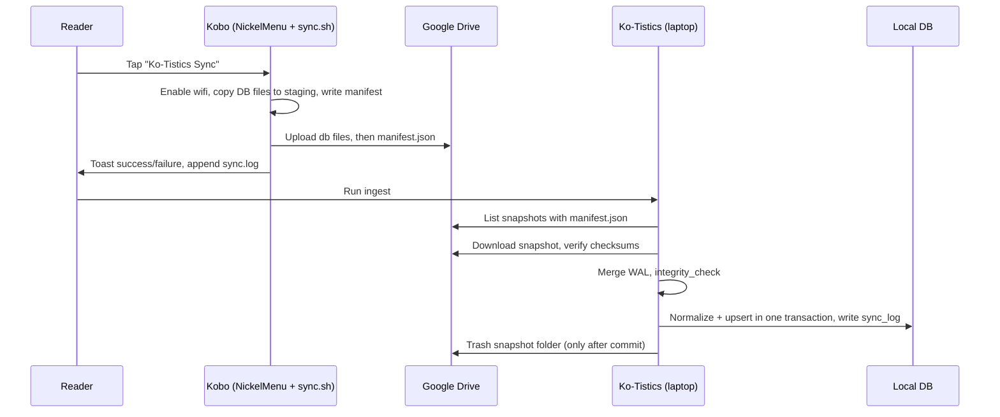

### Kate Macias
### Software Engineering 1
### Fall 2026

# Ko-Tistics Technical Design Document

# Overview

Ko-Tistics syncs reading data from a Kobo e-reader to Google Drive with one tap, so it can feed a personal reading-statistics and progress dashboard.

The system has two halves:
- **Device side (Kobo):** A NickelMenu menu item runs a shell script. The script copies the Kobo database files and uploads them to Google Drive as a timestamped snapshot.
- **Laptop side (Ko-Tistics):** A Python application pulls snapshots from Drive, merges and normalizes them into a local SQLite database, cleans up Drive, and serves a Streamlit dashboard. It also exports a CSV for StoryGraph.

# Actors

- Storygraph user: imports the exported CSV into StoryGraph to update sideloaded book progress
- Kobo reader (device owner): taps the sync menu item on the Kobo, runs Ko-Tistics on the laptop, and views the dashboard
- Google Drive (external system): temporary storage for snapshots between the Kobo and the laptop

# Goals/Non-Goals

## Goals
- easy syncing of reading data from Kobo e-reader to Google Drive with one tap
- capture side loaded reading data
- feed a personal reading-statistics and progress dashboard
- normalized data model
- export CSV for easy storygraph updates

## Non-Goals

- Native storygraph support
- Realtime syncing
- spoofing kobo data syncing with kobo cloud
- Two way syncing. Kobo files remain unchanged after sync
- KOReader support

# Constraints

- personal information must not be stored or shared with any third parties
  - Snapshots go only to the user's own Google Drive account, in a dedicated `Ko-Tistics/` folder
  - OAuth tokens and the local database stay on the user's devices and are excluded from version control (`.gitignore`)
  - No telemetry or analytics calls
- does not interfere with Kobo UI/Firmware
  - Device-side files live only under `/mnt/onboard/.adds/kotistics/` and the NickelMenu config file
  - The sync script only reads from `/mnt/onboard/.kobo/` and never writes to it
- intermittent wifi connectivity (eReaders are used primarily offline)
  - Sync is user-initiated and fails cleanly when wifi is unavailable
  - Laptop ingestion processes all pending snapshots in timestamp order, so several offline syncs can be caught up at once

# Assumptions

- NickelMenu has already been installed
- Working on compatible kobo device
- Kobo database schema stays consistent through firmware updates
- All reading data is being captured by KoboReader.sqlite file
- Wifi will be available for syncing
- Side loaded books may have the wrong metadata

# Non-Functional Requirements

 - Failed syncs do not leave corrupted data
   - Device: the snapshot manifest is uploaded last and acts as a commit marker. Snapshots without a manifest are ignored.
   - Laptop: each snapshot is ingested inside a single SQLite transaction. On any error the transaction rolls back and the Drive snapshot is kept for retry.
 - all syncs include -wal file that is merged
   - `KoboReader.sqlite`, `KoboReader.sqlite-wal`, and `KoboReader.sqlite-shm` (if present) are copied together. The merged result must pass `PRAGMA integrity_check` before it is ingested.
 - Every sync is timestamped and logged success or failure
   - Device: one line per run is appended to `/mnt/onboard/.adds/kotistics/sync.log`, and the result is shown to the user as a toast
   - Laptop: one row per snapshot is written to the `sync_log` table, plus a rotating text log at `logs/kotistics.log`
 - Easy to set up again if firmware update removes modifications
   - All device files sit in `.adds/kotistics/` and survive firmware updates, so only NickelMenu needs reinstalling
   - The repo includes an `install/` folder holding the NickelMenu config, the sync script, and setup steps
 - Re-ingesting the same snapshot is idempotent: snapshot IDs are recorded, and duplicates are skipped

# Component Diagram and Description



| Component | Description |
|-----------|-------------|
| KOBO | E-reader running a NickelMenu custom one tap sync |
| Google Drive | Holds timestamped database snapshots until Ko-Tistics fetches them. |
| Ko-Tistics | Python application on the laptop that coordinates fetching, merging, normalizing, and cleanup. |
| merge files | Combines each snapshot's `.sqlite` and `-wal` files into one standalone database so no recent progress is lost. |
| normalize data | Filters to sideloaded books and converts Kobo's raw columns into usable, normalized data structure. |
| local normalized database | SQLite database storing the normalized data for the dashboard. |
| Streamlit Dashboard | Local web dashboard that displays reading statistics and progress over time. |
| Drive Cleanup | Deletes ingested snapshots from Google Drive after the local database update succeeds. |

## Sync Sequence



## KOBO (Device Side)

**NickelMenu entry** (`/mnt/onboard/.adds/nm/kotistics`):
```
menu_item :main :Ko-Tistics Sync :nickel_wifi :autoconnect_silent
  chain_success :cmd_spawn :quiet :exec /mnt/onboard/.adds/kotistics/sync.sh
  chain_failure :dbg_toast :Ko-Tistics: no wifi, sync skipped
```

**Files under `/mnt/onboard/.adds/kotistics/`:**

| File | Purpose |
|------|---------|
| `sync.sh` | Sync script (BusyBox `sh`) |
| `rclone` | Static ARMv7 rclone binary used for the Drive upload |
| `rclone.conf` | rclone remote `gdrive:` authorized to the user's Drive |
| `staging/` | Temporary copy location, cleared at the start of each run |
| `sync.log` | Device-side run log |

**`sync.sh` steps:**
1. Build the snapshot ID from the UTC time: `TS=$(date -u +%Y%m%dT%H%M%SZ)`.
2. Clear `staging/`, then copy `KoboReader.sqlite`, `-wal`, and `-shm` (if present) from `/mnt/onboard/.kobo/`, copying the main file and the WAL back-to-back to keep them close in time.
3. Write `manifest.json` containing `snapshot_id`, `created_utc`, the file list, the size of each file, and the md5 checksum of each file (`md5sum`).
4. `rclone copy` the db files to `gdrive:Ko-Tistics/inbox/<TS>/`, then upload `manifest.json` last.
5. Append `<TS> OK` or `<TS> FAIL <step>` to `sync.log` and show a result toast with `qndb`, if installed. If not, the log is the record.
6. Exit non-zero on any failure. A partial upload has no manifest and is ignored by the laptop.

## Google Drive

- Folder layout: `Ko-Tistics/inbox/<snapshot_id>/{KoboReader.sqlite, KoboReader.sqlite-wal, KoboReader.sqlite-shm, manifest.json}`
- A snapshot is "complete" only when `manifest.json` exists.
- Drive's `md5Checksum` field is compared to the manifest checksums before anything is downloaded.

## Ko-Tistics (Laptop Application)

- **Stack:** Python 3, `google-api-python-client` + `google-auth-oauthlib` (installed-app OAuth flow, token cached in `~/.kotistics/token.json`), `sqlite3` (stdlib), `pandas`, `streamlit`
- **CLI entry points:**
  - `kotistics ingest`: fetch, merge, normalize, and clean up all pending snapshots
  - `kotistics export-csv [--out path]`: write the StoryGraph CSV
  - `kotistics dashboard`: launch Streamlit
- **Ingest loop:** List complete snapshots in `inbox/`, sorted by `snapshot_id`, and skip any already in `sync_log` with status `success`. For each snapshot: download → verify → merge → normalize → commit → cleanup. A failure is logged, and the loop moves on to the next snapshot.

## merge files

1. Download the snapshot into a temp directory, keeping the original filenames so SQLite pairs the WAL with the database.
2. Open `KoboReader.sqlite` read-write (not `immutable`) so that SQLite replays the WAL.
3. Run `PRAGMA wal_checkpoint(TRUNCATE);`, then `VACUUM INTO 'merged.sqlite';` to produce one standalone file.
4. Run `PRAGMA integrity_check;` on `merged.sqlite`. Any result other than `ok` stops processing with status `corrupt`, and the Drive snapshot is kept.

## normalize data

**Source query** (sideloaded books only):
```sql
SELECT ContentID, Title, Attribution, ISBN, ___PercentRead,
       ReadStatus, DateLastRead, TimeSpentReading
FROM content
WHERE ContentType = 6
  AND ContentID LIKE 'file:///mnt/onboard/%';
```

**Transformations:**

| Kobo column | Normalized field | Rule |
|-------------|------------------|------|
| `ContentID` | `books.content_id` | Natural key (file path on device) |
|
