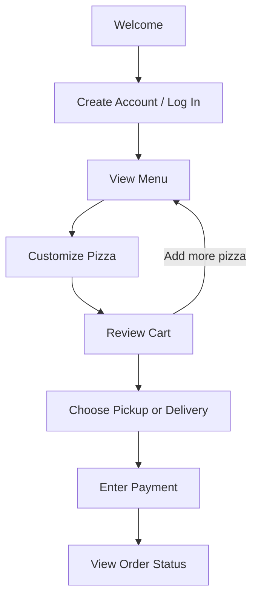

### Kate Macias
### Software Engineering 1
### Fall 2026

# Functional Specification

## UX Flows

## Wireframes

## Prototype

**[▶ Open the live prototype](https://kemacias.github.io/Software_Engineering_1/)**
