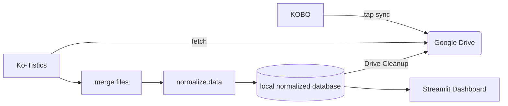

### Kate Macias
### Software Engineering 1
### Fall 2026

# Ko-Tistics Technical Design Document

# Overview

Ko-Tistics syncs reading data from a Kobo e-reader to Google Drive with one tap, so it can feed a personal reading-statistics and progress dashboard.

# Actors

- Storygraph user 
- 

# Goals/Non-Goals

## Goals
- easy syncing of reading data from Kobo e-reader to Google Drive with one tap
- capture side loaded reading data
- feed a personal reading-statistics and progress dashboard
- normalized data model
- export CSV for easy storygraph updates

## Non_Goals

- Native storygraph support
- Realtime syncing
- spoofing kobo data syncing with kobo cloud
- Two way syncing. Kobo files remain unchanged after sync
- KO reader support

# Constraints

- personal information must not be stored or shared with any third parties
- does not interfere with Kobo UI/Firmware
- intermitent wifi connectivity (eReaders are used primarily offline)

# Assumptions

- Nickel Menue has already been installed
- Working on compatable kobo device
- Kobo database schema stays consistent through firmware updates
- All reading data is being captured by KoboReader.sqlite file
- Wifi will be available for syncing
- Side loaded books may have the wrong metadata 

# Non-Functional Requirements

 - Failed syncs do not leave corrupted data
 - all syncs incluse -wal file that is merged 
 - Every sync is timestamped and logged success or failure
 - Easy to set up again if firmware update removes modifications
 -  

# Component Diagram and Description

