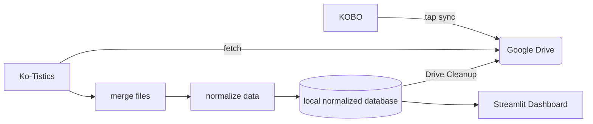

### Kate Macias
### Software Engineering 1
### Fall 2026

# Ko-Tistics Technical Design Document

# Overview

Ko-Tistics syncs reading data from a Kobo e-reader to Google Drive with one tap, so it can feed a personal reading-statistics and progress dashboard.

# Actors

- Storygraph user 
- 

# Goals/Non-Goals

## Goals
- easy syncing of reading data from Kobo e-reader to Google Drive with one tap
- capture side loaded reading data
- feed a personal reading-statistics and progress dashboard
- normalized data model
- export CSV for easy storygraph updates

## Non_Goals

- Native storygraph support
- Realtime syncing
- spoofing kobo data syncing with kobo cloud
- Two way syncing. Kobo files remain unchanged after sync
- KO reader support

# Constraints

- personal information must not be stored or shared with any third parties
- does not interfere with Kobo UI/Firmware
- intermitent wifi connectivity (eReaders are used primarily offline)

# Assumptions

- Nickel Menue has already been installed
- Working on compatable kobo device
- Kobo database schema stays consistent through firmware updates
- All reading data is being captured by KoboReader.sqlite file
- Wifi will be available for syncing
- Side loaded books may have the wrong metadata 

# Non-Functional Requirements

 - Failed syncs do not leave corrupted data
 - all syncs incluse -wal file that is merged 
 - Every sync is timestamped and logged success or failure
 - Easy to set up again if firmware update removes modifications
 -  

# Component Diagram and Description

| Component | Description |
|-----------|-------------|
| KOBO | E-reader running a NickelMenu custom one tap sync |
| Google Drive | Holds timestamped database snapshots until Ko-Tistics fetches them. 
| Ko-Tistics | Python application on the laptop that coordinates fetching, merging, normalizing, and cleanup. |
| merge files | Combines each snapshot's `.sqlite` and `-wal` files into one standalone database so no recent progress is lost. |
| normalize data | Filters to sideloaded books and converts Kobo's raw columns into usable, normalized data structure. |
| local normalized database | SQLite database storing the normalized data for the dashboard. |
| Streamlit Dashboard | Local web dashboard that displays reading statistics and progress over time. |
| Drive Cleanup | Deletes ingested snapshots from Google Drive after the local database update succeeds. |

# Data Model
## ER Diagram

```mermaid
erDiagram
    %% Normalized reading-data schema derived from KoboReader.sqlite
    %% Quoted comments show the source column in the original Kobo database.

    book {
        text book_id PK "content.ContentID"
        text title "content.Title"
        text subtitle "content.Subtitle"
        text isbn "content.ISBN"
        text publisher "content.Publisher"
        text language "content.Language"
        text series_id FK "content.SeriesID"
        real series_number "content.SeriesNumberFloat"
        int word_count "content.WordCount (-1 = unknown)"
        int pages "content.___NumPages"
        text source "derived from ContentID: sideloaded or google_drive"
        datetime date_added "content.DateAdded"
    }

    author {
        int author_id PK "generated"
        text name "split from content.Attribution"
    }

    book_author {
        text book_id PK, FK
        int author_id PK, FK
        int position "order listed in Attribution"
    }

    series {
        text series_id PK "content.SeriesID"
        text name "content.Series"
    }

    snapshot {
        int snapshot_id PK "generated"
        datetime taken_at "from file name timestamp"
        text file_name "KoboReader-YYYYMMDD-HHMMSS.sqlite"
    }

    reading_status {
        int status_id PK "content.ReadStatus code"
        text label "unread, reading, finished"
    }

    reading_state {
        int snapshot_id PK, FK
        text book_id PK, FK
        int status_id FK "content.ReadStatus"
        int percent_read "content.___PercentRead"
        real minutes_read "content.TimeSpentReading"
        int sessions "content.TimesStartedReading"
        datetime last_read "content.DateLastRead"
        datetime started_at "content.LastTimeStartedReading"
        datetime finished_at "content.LastTimeFinishedReading"
    }

    highlight {
        text highlight_id PK "Bookmark.BookmarkID"
        text book_id FK "Bookmark.VolumeID"
        text type "Bookmark.Type"
        text quote "Bookmark.Text"
        text note "Bookmark.Annotation"
        real chapter_progress "Bookmark.ChapterProgress"
        int color "Bookmark.Color"
        datetime created_at "Bookmark.DateCreated"
        datetime modified_at "Bookmark.DateModified"
    }

    shelf {
        text shelf_id PK "Shelf.Id"
        text name "Shelf.Name"
        datetime created_at "Shelf.CreationDate"
    }

    shelf_book {
        text shelf_id PK, FK "via ShelfContent.ShelfName"
        text book_id PK, FK "ShelfContent.ContentId"
        datetime added_at "ShelfContent.DateModified"
    }

    rating {
        text book_id PK, FK "ratings.ContentID"
        int stars "ratings.Rating"
        text review "ratings.Review"
        datetime rated_at "ratings.DateModified"
    }

    word_lookup {
        text word PK "WordList.Text"
        text book_id FK "WordList.VolumeId"
        text dictionary "WordList.DictSuffix"
        datetime looked_up_at "WordList.DateCreated"
    }

    book ||--o{ book_author : "written by"
    author ||--o{ book_author : "writes"
    series |o--o{ book : "contains"
    snapshot ||--o{ reading_state : "captures"
    book ||--o{ reading_state : "tracked in"
    reading_status ||--o{ reading_state : "describes"
    book ||--o{ highlight : "has"
    shelf ||--o{ shelf_book : "holds"
    book ||--o{ shelf_book : "placed on"
    book ||--o| rating : "rated"
    book ||--o{ word_lookup : "looked up in"
```

# Interfaces
## Interface Summary
The Ko-Tistics dashboard is a python module that utilizes Streamlit to display reading statistics. It has six public functions that cover downloading the kobo database file and storing it in a google drive. From here it is parsed, normalized and stored in a database locally. No function writes to the kobo or changes it in any way after the initial NickelMenu setup. 

## Interface Functions
push_data(): pushes raw sqlite file from kobo to google drive folder. VALID if complete file is pushed. 
data_fetch(): fetches the latest kobo database file from google drive and combines sqlite and wal files. VALID if file is successfully fetched.
parse_data(): parses raw sqlite file from kobo into a dataframe. VALID if file is successfully parsed.
normalize_data(): normalizes parsed data into a consistent format. VALID if data is successfully normalized.
store_data(): stores normalized data in the local database. VALID if data is successfully stored.
query_data(): queries the local database for reading statistics for display on the dashboard 

# Invariants

  ### The kobo database is read-only to Ko-Tistics
  - The app never alters KoboReader.sqlite on the device, or the copied file in the drive. 
  ### Reading progress never goes backwards
  - stats don't go backwards or reset back to zero unless the whole system is reset. 
  ### Every book has one record for accurate stats
  - Only complete data is displayed on the dashboard. 
  ### Only complete data is displayed on the dashboard.
  - any incomplete data is filtered out.

# Failure Modes

| ID | Failure | Response | Impact | Notification |
|---|---|---|---|---|
| Incomplete_Data | SQLite file not fetched or stored in Drive | Save warning file | Data loss | Data loss notification |
| parse_error | Parsing error occurs while processing data | Save warning file | Data loss | Data loss notification |
| no_new_data | No new data is available for processing | Save warning file | Data loss | Data loss notification |
| NM_down | NickelMenu is removed by firmware update | Save warning file | Data loss | Data loss notification |
