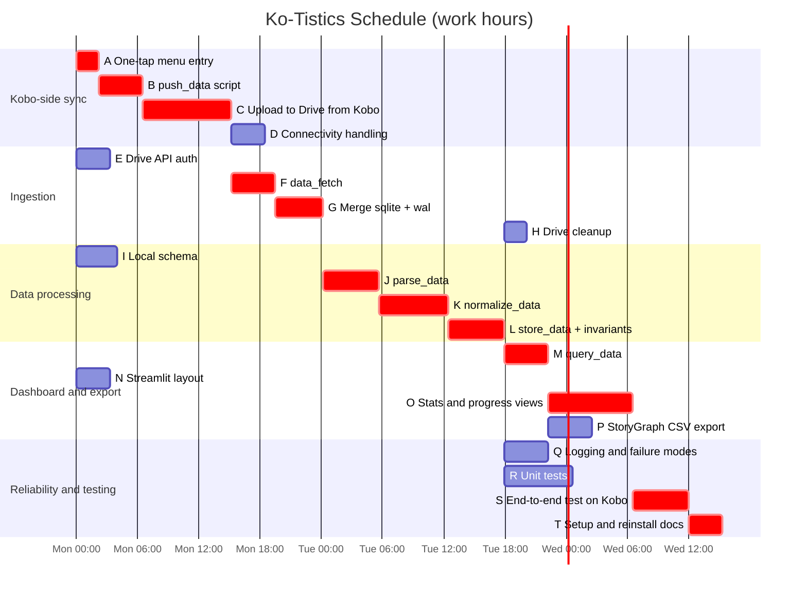

### Kate Macias
### Software Engineering 1
### Fall 2026

# Ko-Tistics Estimation and Schedule

All estimates are in **hours of focused work**

# Work Breakdown Structure

- **1 Ko-Tistics**
  - **1.1 Kobo-side sync (NickelMenu)**
    - **1.1.1 One-tap menu entry** (A)
      - Write NickelMenu config item
      - Test the menu appears and runs the script
    - **1.1.2 `push_data()` snapshot script** (B)
      - Copy `KoboReader.sqlite` and `-wal` together
      - Timestamped file name `KoboReader-YYYYMMDD-HHMMSS.sqlite`
    - **1.1.3 Upload to Google Drive from the Kobo** (C)
      - Store Drive credentials on the device
      - Upload snapshot pair to the Drive folder
    - **1.1.4 Connectivity handling** (D)
      - Check for Wi-Fi before pushing
      - Retry, and write a push log entry (success/failure)
  - **1.2 Ingestion (laptop)**
    - **1.2.1 Google Drive API auth** (E)
    - **1.2.2 `data_fetch()`** (F)
      - List and download un-ingested snapshots
    - **1.2.3 Merge `.sqlite` + `-wal`** (G)
      - Checkpoint WAL into a standalone database copy
      - Verify integrity before continuing
    - **1.2.4 Drive cleanup** (H)
      - Delete snapshots only after a successful store
  - **1.3 Data processing**
    - **1.3.1 Local normalized schema** (I)
      - Create tables from the ER diagram
    - **1.3.2 `parse_data()`** (J)
      - Read `content`, `Bookmark`, `Shelf`, `ShelfContent`, `ratings`, `WordList`
    - **1.3.3 `normalize_data()`** (K)
      - Filter to sideloaded books
      - Split authors, map series and read status
    - **1.3.4 `store_data()`** (L)
      - Insert snapshot and reading state
      - Enforce invariants (progress never goes backwards, one record per book)
  - **1.4 Dashboard and export**
    - **1.4.1 `query_data()`** (M)
    - **1.4.2 Streamlit layout and navigation** (N)
    - **1.4.3 Statistics and progress views** (O)
      - Minutes read over time, books finished, current progress
    - **1.4.4 StoryGraph CSV export** (P)
  - **1.5 Reliability and testing**
    - **1.5.1 Logging and failure modes** (Q)
      - Warning files and notifications for each failure mode
    - **1.5.2 Unit tests** (R)
      - Parser, normalizer, invariants
    - **1.5.3 End-to-end test on the Kobo** (S)
    - **1.5.4 Setup and reinstall docs** (T)
      - Recovery steps after a firmware update removes NickelMenu

# PERT Estimates

E = (O + 4M + P) / 6

| ID | Task | O | M | P | E |
|---|---|---|---|---|---|
| A | One-tap menu entry | 1 | 2 | 4 | 2.2 |
| B | `push_data()` snapshot script | 2 | 4 | 8 | 4.3 |
| C | Upload to Drive from the Kobo | 4 | 8 | 16 | 8.7 |
| D | Connectivity handling | 2 | 3 | 6 | 3.3 |
| E | Google Drive API auth | 2 | 3 | 6 | 3.3 |
| F | `data_fetch()` | 2 | 4 | 8 | 4.3 |
| G | Merge `.sqlite` + `-wal` | 2 | 4 | 10 | 4.7 |
| H | Drive cleanup | 1 | 2 | 4 | 2.2 |
| I | Local normalized schema | 2 | 4 | 6 | 4.0 |
| J | `parse_data()` | 3 | 5 | 10 | 5.5 |
| K | `normalize_data()` | 4 | 6 | 12 | 6.7 |
| L | `store_data()` + invariants | 3 | 5 | 10 | 5.5 |
| M | `query_data()` | 2 | 4 | 8 | 4.3 |
| N | Streamlit layout | 2 | 3 | 6 | 3.3 |
| O | Statistics and progress views | 4 | 8 | 14 | 8.3 |
| P | StoryGraph CSV export | 2 | 4 | 8 | 4.3 |
| Q | Logging and failure modes | 2 | 4 | 8 | 4.3 |
| R | Unit tests | 4 | 6 | 12 | 6.7 |
| S | End-to-end test on the Kobo | 3 | 5 | 10 | 5.5 |
| T | Setup and reinstall docs | 2 | 3 | 6 | 3.3 |
| | **Total** | | | | **94.7** |

# Monte Carlo Estimate

20,000 simulated runs, sampling each task from a PERT (beta) distribution and summing all tasks (one developer, tasks done one at a time).

| Percentile | Hours |
|---|---|
| p50 | ~95 |
| **p90** | **~102** |

**p90 estimate: about 102 hours of work.**

# CPM Table

| Task | Duration | Dependencies | ES | EF | LS | LF | Slack |
|---|---|---|---|---|---|---|---|
| A | 2.2 | — | 0.0 | 2.2 | 0.0 | 2.2 | 0.0 |
| B | 4.3 | A | 2.2 | 6.5 | 2.2 | 6.5 | 0.0 |
| C | 8.7 | B | 6.5 | 15.2 | 6.5 | 15.2 | 0.0 |
| D | 3.3 | C | 15.2 | 18.5 | 46.9 | 50.2 | 31.7 |
| E | 3.3 | — | 0.0 | 3.3 | 11.9 | 15.2 | 11.9 |
| F | 4.3 | C, E | 15.2 | 19.5 | 15.2 | 19.5 | 0.0 |
| G | 4.7 | F | 19.5 | 24.2 | 19.5 | 24.2 | 0.0 |
| H | 2.2 | L | 41.9 | 44.1 | 52.3 | 54.5 | 10.4 |
| I | 4.0 | — | 0.0 | 4.0 | 25.7 | 29.7 | 25.7 |
| J | 5.5 | G | 24.2 | 29.7 | 24.2 | 29.7 | 0.0 |
| K | 6.7 | I, J | 29.7 | 36.4 | 29.7 | 36.4 | 0.0 |
| L | 5.5 | K | 36.4 | 41.9 | 36.4 | 41.9 | 0.0 |
| M | 4.3 | L | 41.9 | 46.2 | 41.9 | 46.2 | 0.0 |
| N | 3.3 | — | 0.0 | 3.3 | 42.9 | 46.2 | 42.9 |
| O | 8.3 | M, N | 46.2 | 54.5 | 46.2 | 54.5 | 0.0 |
| P | 4.3 | M | 46.2 | 50.5 | 50.2 | 54.5 | 4.0 |
| Q | 4.3 | D, L | 41.9 | 46.2 | 50.2 | 54.5 | 8.3 |
| R | 6.7 | L | 41.9 | 48.6 | 47.8 | 54.5 | 5.9 |
| S | 5.5 | H, O, P, Q, R | 54.5 | 60.0 | 54.5 | 60.0 | 0.0 |
| T | 3.3 | S | 60.0 | 63.3 | 60.0 | 63.3 | 0.0 |

**Critical path:** A → B → C → F → G → J → K → L → M → O → S → T (63.3 hours)

# Gantt Chart

Times on the axis are elapsed work hours, starting from hour 0. Red bars are the critical path.

