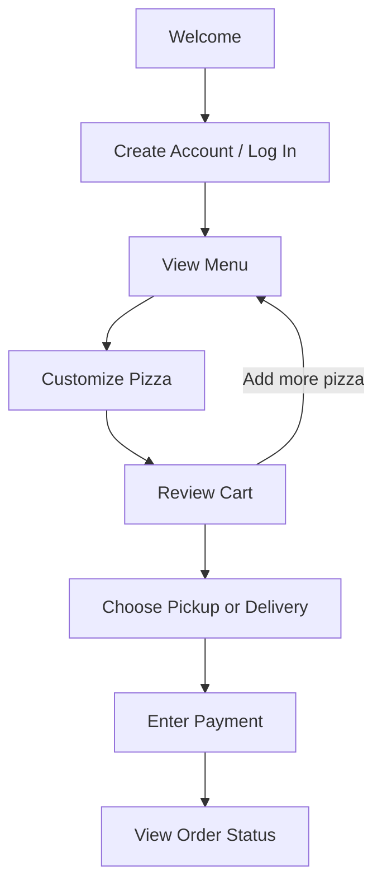

### Kate Macias
### Software Engineering 1
### Fall 2026

# Functional Specification

## UX Flows

# Slice Lab Wireframes

**Use case:** Place an Order
**Actor:** Customer (Captain Riz, a first-time customer)
**First screen:** Welcome Screen

Low-fidelity wireframes, one per screen, in the order the customer sees them. Dashed gray boxes are annotations for states that aren't drawn separately (for example, error messages). They are not part of the UI.

| # | Screen | Leads to |
|---|--------|----------|
| 1 | Welcome Screen | Create Account Screen |
| 2 | Create Account Screen | Menu Screen |
| 3 | Menu Screen | Customize Pizza Screen, Cart Screen |
| 4 | Customize Pizza Screen | Cart Screen |
| 5 | Cart Screen | Pickup or Delivery Screen, Menu Screen |
| 6 | Pickup or Delivery Screen | Payment Screen |
| 7 | Payment Screen | Order Status Screen |
| 8 | Order Status Screen | End: order picked up or delivered |

---

## 1. Welcome Screen

The first screen the customer sees. A first-time customer taps **Create an account**. Returning customers tap **I already have an account**.

## 2. Create Account Screen

The customer enters their name, email, password, and delivery address, then taps **Create account**. Invalid fields show an error and the customer stays on this screen.

## 3. Menu Screen

The customer browses Pizzas, Sides, and Drinks. **Customize** opens a pizza's options. The cart bar shows the item count and total and links to the cart.

## 4. Customize Pizza Screen

The customer picks a size and crust, and sets each topping to None, Regular, or Extra. The price updates, and **Add to cart** saves the pizza.

## 5. Cart Screen

The customer reviews items, changes quantities, or removes items. **Add more items** returns to the menu. **Continue** moves on to fulfillment.

## 6. Pickup or Delivery Screen

The customer chooses **Pickup** (store and pickup time) or **Delivery** (saved address or a different one, plus a delivery fee). The total updates to match.

## 7. Payment Screen

The customer enters card details and checks the order summary, then taps **Place order**. A declined card shows an error and the customer tries again.

## 8. Order Status Screen

Confirms the order and shows the order number, ready time, and progress. The customer taps **Check status** until the order is ready, then picks it up.

## Prototype

**[▶ Open the live prototype](https://kemacias.github.io/Software_Engineering_1/)**
